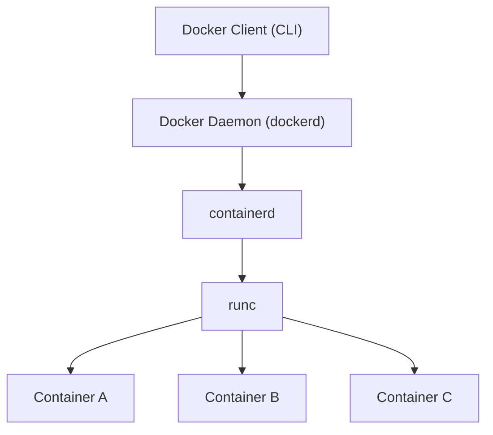

# Docker

## Architecture



## Installation

Go to the [Docker Installation Homepage](https://docs.docker.com/engine/install/), choose your OS and follow the steps.

## Process of a container

### How to find it in most Linux Distros

```bash
ps aux | grep <container-name>
	# Works e.g. on RHEL and Ubuntu
```

## Basic Commands

### docker version

```bash
docker version
	# Detailed information.
```

or

```bash
docker -v
	# Less detailed inforamtion.
```

or

```bash
docker info
	# Very detailed information.
	# "Docker Root Dir: /var/lib/docker" shows where Docker is installed.
	# It's not recommended to change / move something in Docker's path.
```

### docker run

```bash
docker run <OPTIONS> <IMAGE> <COMMAND>
	# Creates and starts a container from a specified image in a single step
```

#### Examples

```bash
docker run hello-world
	# 1. Docker client contacts the Docker daemon (dockerd).
	# 2. Docker daemon checks whether the "hello-world" image
	#    is already available locally.
	# 3. If the image is not present, Docker daemon pulls it
	#    from Docker Hub via the image distribution infrastructure.
	# 4. Docker daemon asks containerd to create and start
	#    a new container from the image.
	# 5. containerd uses runc to create and start the container.
	# 6. The hello-world container executes its program
	#    and produces output.
	# 7. The output is passed back through the Docker daemon
	#    to the Docker client and displayed in the terminal.
```

```bash
docker run --name hellu hello-world
	# Pulls the image if not installed and starts the container as "hellu"
```

```bash
docker run -d nginx
	# "-d" means detached mode
	# Process will be created and started in the background
	# Docker Host will not see Containers CLI
```

```bash
docker run -it ubuntu /bin/bash
	# "docker run -it ubuntu bash" does the same
		# works only when the bash shell is in the container $PATH included
```

```bash
docker run --rm ubuntu echo "this will self-destruct"
	# Creates and runs an ubuntu container
	# does an echo, and deletes container afterwards
	# Good for testing (e.g. curl, ping, ...)
	# Not for long term containers!
```

```bash
docker run --rm -it --name py1 python /bin/bash
	# Creates and runs an python container
	# Opens a shell
	# Deletes container after user exits the shell
```

```bash
docker run -it --rm ubuntu bash
	# Deletes container after user exits from the shell
```

```bash
docker run --name ubuntu2 -itd ubuntu bash
	# You can enter in Ubunter after that everytime
	# Enter in Ubuntus pseudo TTY with "docker exec -it ubuntu2 bash"
```

```bash
docker run -itd ubuntu bash -c "echo 'Hello' > /data/hello.txt"
	# Works only if the "/data" path got mounted from volumes
```

```bash
docker run -p 80:80 imageexp
	# "-p" maps the host port (left) with the container port (right)
```

### docker pull

```bash
docker pull <OPTIONS> <IMAGE[:TAG|@DIGEST]>
```

#### Examples

```bash
docker pull ubuntu
	# pulls latest version of the image ubuntu
```

```bash
docker pull ubuntu:20.04
	# pulls version 20.04 of the image ubuntu
```

```bash
docker pull --all-tags ubuntu
	# pulls all versions of the image ubuntu
```

### docker images

```bash
docker images <OPTIONS>
	# lists the local available Docker images
```

#### Examples

```bash
docker images -q
	# lists all available image IDs
```

### docker ps

```bash
docker ps <OPTIONS>
	# lists the running containers on the Docker host
```

#### Examples

```bash
docker ps -a
	# lists the stopped and the running containers
	# provides information about: status, ID, name, ...
```

### docker create

Creates a container in a stopped state:

```bash
docker create <OPTIONS> <IMAGE> <COMMAND> <ARG...>
```

#### Examples

```bash
docker create --name my-container nginx
```

```bash
docker create --name my-container ubuntu:24.04
```

Note: Without "--name" it would search in Docker Hub.

### docker start

```bash
docker start <OPTIONS> <CONTAINER>
	# Starts an already created, not running container
	# <CONTAINER> could be the name or ID of the container
```

#### Examples

```bash
docker start my-container
	# Start by name.
```

```bash
docker start abc1234
	# Start by ID
```

```bash
docker start container1 container2
	# Start multiple containers
```

### docker stop

```bash
docker stop <OPTIONS> <CONTAINER>
	# Stops a container gracefully
	# If the process doesn't terminate within a certain timeout period
	# (by default 10 seconds)
```

#### Examples

```bash
docker stop my-container
	# stops the container within 10 seconds gracefully
```

```bash
docker stop -t 30 my-container
	# stops the container within 30 seconds gracefully
```

```bash
docker stop container1 container2
	# stops the containers within 10 seconds gracefully
```

### docker exec

```bash
docker exec <OPTIONS> <CONTAINER> <COMMAND>
	# Executes commands inside a running Docker container
	# Should be used with non-interactive commands that do not expect user input
	# Examples: ls, cat, echo, ...
```

#### Examples

```bash
docker exec my-container ls /usr/src/app
```

```bash
docker exec -t my-container ls /usr/src/app
	# Allocates a terminal (tty) to run interactive commands within the container
	# Gives a formatted output
```

```bash
docker exec -i my-container cat /etc/hostname
	# "-i" is the same as "-interactive"
	# Keeps the Stdin open and allows to send commands to the container
	# Should be used with interactive commands that expect user input
	# Examples: vim, bash, sh, ...
```

```bash
docker exec -it my-container login
	# Login works only with the "-i" and the "-t" option
```

```bash
docker exec -it my-container /bin/bash
	# logs into the container
	# Same as "docker exec -it nginx1 bash"
	# "/bin/bash" specifies the type of the shell
		# Examples: bash, sh, Zsh, ...
```

```bash
docker exec -it my-container /etc/shells
	# Finds out which shells are available for this container
```

### docker rm

```bash
docker rm <CONTAINER>
	# Deletes a stopped container by its name or ID
```

#### Examples

```bash
docker rm my-container
```

```bash
docker rm container1 container2
	# Deletes multiple containers at once
```

```bash
docker rm -f $(docker ps -aq)
	# Deletes all containers
```

Info: `docker rm -f *` would take every file in the current path and replace it with the `*`. Use the command above instead.

### docker rmi

```bash
docker rmi <IMAGE>
	# Deletes an image by its name or ID
```

#### Examples

```bash
docker rmi nginx
```

```bash
docker rmi nginx ubuntu
	# Deletes multiple containers at once
```

```bash
docker rmi nginx ubuntu -f
	# Deletes multiple containers at once, even if they have attached containers
	# Containers will remain
```

```bash
docker rmi -f $(docker images -q)
	# Deletes all images
```

### docker inspect

```bash
docker inspect <OPTIONS> <OBJECT>
	# Returns detailed, low-level information in JSON format
	# Can be used on: containers, images, volumes or networks
```

#### Examples

```bash
docker inspect my-container
```

```bash
docker inspect nginx:latest
```

### docker logs

```bash
docker logs <OPTIONS> <CONTAINER>
	# Displays logs
```

#### Examples

```bash
docker logs my-container
```

```bash
docker logs -f my-container
	# Displays logs and updates the terminal with newest logs
```

### docker --help

```bash
docker --help
	# Shows help documentation for Docker
```

#### Examples

```bash
docker run --help
	# Shows available options and flags for docker run command
	# Works also with: commit, create, inspct, ...
```

### docker image prune

```bash
docker image prune <OPTIONS>
	# Deletes unused Docker images
```

#### Examples

```bash
docker image prune
	# Deletes all unused Docker images without a tag
```

```bash
docker image prune -a
	# Deletes all unused Docker images, even with a tag
	# Doesn't delete images used by containers
```

### docker commit

The commit command saves the current state of an image.

```bash
docker commit <CONTAINER> <NAME>:<TAG>
	# Choose a custom <NAME> and <TAG>
```

#### Examples

```bash
docker commit ubuntu1 ubuntu-python:v1
	# Example:
	# If you create a container with the following command
	# "docker run -it --name ubuntu1 ubuntu /bin/bash"
	# and you're intalling python on it "apt update && apt install python3 -y"
	# then you will lose the installed Python without saving the image version

docker run -it --name ubuntu2 ubuntu-python:v1 /bin/bash
	# Use new image
	# Test for Python: "python3 --version"
```

### docker history

```bash
docker history <IMAGE>
	# Displays image layers and their details
```

#### Examples

```bash
docker history nginx
```

### docker build

Creates an image based on a Docker File.
Docker build means: "Take this folder and make its contents available for the build process."

```bash
docker build <OPTIONS> <PATH>
	# <PATH> Example: "/opt/my-app/"
		# In "/opt/my-app/" can exist "index.html", style.css, ...
	# Can pull an image, if not locally available
```

#### Examples

```bash
docker build -t my-app .
	# "-t" means Tag (You're giving the Docker image a name)
		# Later, you can start a container with "docker run my-app"
	# "my-app." is the <PATH>; "." means the current directory
	# By default, Docker looks for a file named "Dockerfile"
```

```bash
docker build -f files/test.txt -t image3 /imagefiles
	# Dockerfile name: "-f files/test.txt"
	# Dockerfile thinks it is in the Build Context ("/imagefiles")
	# As you can see, the Dockerfile can be located outside the build context
```

> [!TIP]
> You can choose between relative (e.g. like "files/test.txt") and absolute (e.g. like "/imagefiles") paths for the Dockerfile and for the Build Context.

### docker tag

- Used to add a new name (or alias) to an existing Docker image (add a custom name to an image)

```bash
docker tag <SOURCE_IMAGE>:<TAG> <TARGET_IMAGE>:<TAG>
	# Used to assign a new tag to an image, e.g. before pushing it to Docker Hub.
```

#### Examples

```bash
docker tag python:3.10 my-python-app:latest
```

### docker login

In order to push an image to a repository, you have to login first.

```bash
docker login Registry_Host
```

### docker push

```bash
docker push <IMAGE>
	# <IMAGE> = [REGISTRY_HOST/]USERNAME/REPO:TAG
		# Docker Hub doesn't need "REGISTRY_HOST/"
```

#### Examples

```bash
docker push myapp myusername/myapp:latest
	# If Docker Hub
```

```bash
docker push myapp registry.mycorp.com/myusername/myapp:1.0.0
	# If not Docker Hub
```
