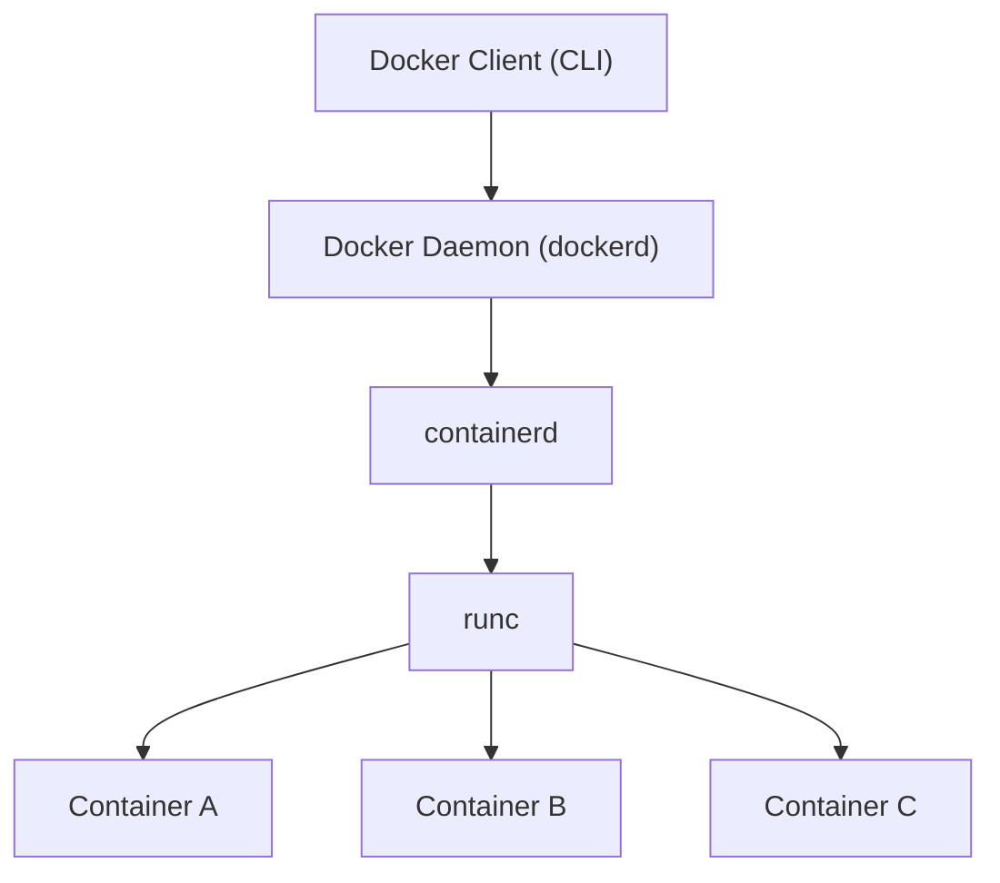
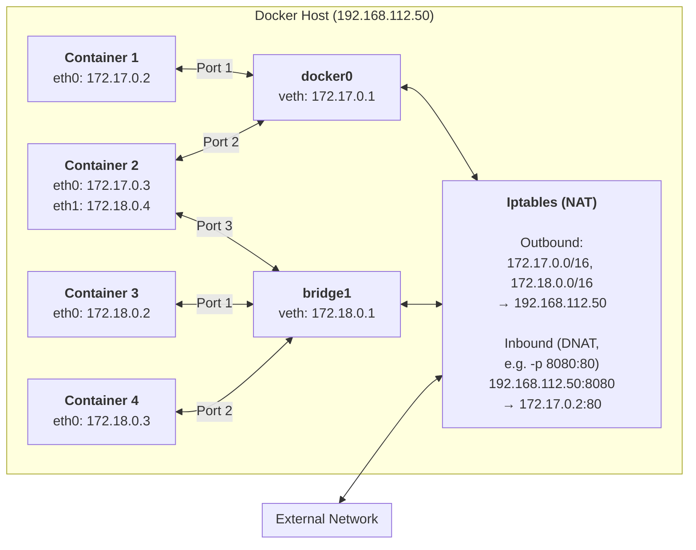

# Docker

## Architecture



## Installation

Go to the [Docker Installation Homepage](https://docs.docker.com/engine/install/), choose your OS and follow the steps.

## Process of a container

### How to find it in most Linux Distros

```bash
ps aux | grep <container-name>
	# Works e.g. on RHEL and Ubuntu
```

## Commands

### docker version

```bash
docker version
	# Detailed information.
```

or

```bash
docker -v
	# Less detailed inforamtion.
```

or

```bash
docker info
	# Very detailed information.
	# "Docker Root Dir: /var/lib/docker" shows where Docker is installed.
	# It's not recommended to change / move something in Docker's path.
```

### docker run

```bash
docker run <OPTIONS> <IMAGE> <COMMAND>
	# Creates and starts a container from a specified image in a single step
```

#### Examples

```bash
docker run hello-world
	# 1. Docker client contacts the Docker daemon (dockerd).
	# 2. Docker daemon checks whether the "hello-world" image
	#    is already available locally.
	# 3. If the image is not present, Docker daemon pulls it
	#    from Docker Hub via the image distribution infrastructure.
	# 4. Docker daemon asks containerd to create and start
	#    a new container from the image.
	# 5. containerd uses runc to create and start the container.
	# 6. The hello-world container executes its program
	#    and produces output.
	# 7. The output is passed back through the Docker daemon
	#    to the Docker client and displayed in the terminal.
```

```bash
docker run --name hellu hello-world
	# Pulls the image if not installed and starts the container as "hellu"
```

```bash
docker run -d nginx
	# "-d" means detached mode
	# Process will be created and started in the background
	# Docker Host will not see Containers CLI
```

```bash
docker run -it ubuntu /bin/bash
	# "docker run -it ubuntu bash" does the same
		# works only when the bash shell is in the container $PATH included
```

```bash
docker run --rm ubuntu echo "this will self-destruct"
	# Creates and runs an ubuntu container
	# does an echo, and deletes container afterwards
	# Good for testing (e.g. curl, ping, ...)
	# Not for long term containers!
```

```bash
docker run --rm -it --name py1 python /bin/bash
	# Creates and runs an python container
	# Opens a shell
	# Deletes container after user exits the shell
```

```bash
docker run -it --rm ubuntu bash
	# Deletes container after user exits from the shell
```

```bash
docker run --name ubuntu2 -itd ubuntu bash
	# You can enter in Ubunter after that everytime
	# Enter in Ubuntus pseudo TTY with "docker exec -it ubuntu2 bash"
```

```bash
docker run -itd ubuntu bash -c "echo 'Hello' > /data/hello.txt"
	# Works only if the "/data" path got mounted from volumes
```

```bash
docker run -p 80:80 imageexp
	# "-p" maps the host port (left) with the container port (right)
```

### docker pull

```bash
docker pull <OPTIONS> <IMAGE[:TAG|@DIGEST]>
```

#### Examples

```bash
docker pull ubuntu
	# pulls latest version of the image ubuntu
```

```bash
docker pull ubuntu:20.04
	# pulls version 20.04 of the image ubuntu
```

```bash
docker pull --all-tags ubuntu
	# pulls all versions of the image ubuntu
```

### docker images

```bash
docker images <OPTIONS>
	# lists the local available Docker images
```

#### Examples

```bash
docker images -q
	# lists all available image IDs
```

### docker ps

```bash
docker ps <OPTIONS>
	# lists the running containers on the Docker host
```

#### Examples

```bash
docker ps -a
	# lists the stopped and the running containers
	# provides information about: status, ID, name, ...
```

### docker create

Creates a container in a stopped state:

```bash
docker create <OPTIONS> <IMAGE> <COMMAND> <ARG...>
```

#### Examples

```bash
docker create --name my-container nginx
```

```bash
docker create --name my-container ubuntu:24.04
```

Note: Without "--name" it would search in Docker Hub.

### docker start

```bash
docker start <OPTIONS> <CONTAINER>
	# Starts an already created, not running container
	# <CONTAINER> could be the name or ID of the container
```

#### Examples

```bash
docker start my-container
	# Start by name.
```

```bash
docker start abc1234
	# Start by ID
```

```bash
docker start container1 container2
	# Start multiple containers
```

### docker stop

```bash
docker stop <OPTIONS> <CONTAINER>
	# Stops a container gracefully
	# If the process doesn't terminate within a certain timeout period
	# (by default 10 seconds)
```

#### Examples

```bash
docker stop my-container
	# stops the container within 10 seconds gracefully
```

```bash
docker stop -t 30 my-container
	# stops the container within 30 seconds gracefully
```

```bash
docker stop container1 container2
	# stops the containers within 10 seconds gracefully
```

### docker exec

```bash
docker exec <OPTIONS> <CONTAINER> <COMMAND>
	# Executes commands inside a running Docker container
	# Should be used with non-interactive commands that do not expect user input
	# Examples: ls, cat, echo, ...
```

#### Examples

```bash
docker exec my-container ls /usr/src/app
```

```bash
docker exec -t my-container ls /usr/src/app
	# Allocates a terminal (tty) to run interactive commands within the container
	# Gives a formatted output
```

```bash
docker exec -i my-container cat /etc/hostname
	# "-i" is the same as "-interactive"
	# Keeps the Stdin open and allows to send commands to the container
	# Should be used with interactive commands that expect user input
	# Examples: vim, bash, sh, ...
```

```bash
docker exec -it my-container login
	# Login works only with the "-i" and the "-t" option
```

```bash
docker exec -it my-container /bin/bash
	# logs into the container
	# Same as "docker exec -it nginx1 bash"
	# "/bin/bash" specifies the type of the shell
		# Examples: bash, sh, Zsh, ...
```

```bash
docker exec -it my-container /etc/shells
	# Finds out which shells are available for this container
```

### docker rm

```bash
docker rm <CONTAINER>
	# Deletes a stopped container by its name or ID
```

#### Examples

```bash
docker rm my-container
```

```bash
docker rm container1 container2
	# Deletes multiple containers at once
```

```bash
docker rm -f $(docker ps -aq)
	# Deletes all containers
```

Info: `docker rm -f *` would take every file in the current path and replace it with the `*`. Use the command above instead.

### docker rmi

```bash
docker rmi <IMAGE>
	# Deletes an image by its name or ID
```

#### Examples

```bash
docker rmi nginx
```

```bash
docker rmi nginx ubuntu
	# Deletes multiple containers at once
```

```bash
docker rmi nginx ubuntu -f
	# Deletes multiple containers at once, even if they have attached containers
	# Containers will remain
```

```bash
docker rmi -f $(docker images -q)
	# Deletes all images
```

### docker inspect

```bash
docker inspect <OPTIONS> <OBJECT>
	# Returns detailed, low-level information in JSON format
	# Can be used on: containers, images, volumes or networks
```

#### Examples

```bash
docker inspect my-container
```

```bash
docker inspect nginx:latest
```

### docker logs

```bash
docker logs <OPTIONS> <CONTAINER>
	# Displays logs
```

#### Examples

```bash
docker logs my-container
```

```bash
docker logs -f my-container
	# Displays logs and updates the terminal with newest logs
```

### docker --help

```bash
docker --help
	# Shows help documentation for Docker
```

#### Examples

```bash
docker run --help
	# Shows available options and flags for docker run command
	# Works also with: commit, create, inspct, ...
```

### docker image prune

```bash
docker image prune <OPTIONS>
	# Deletes unused Docker images
```

#### Examples

```bash
docker image prune
	# Deletes all unused Docker images without a tag
```

```bash
docker image prune -a
	# Deletes all unused Docker images, even with a tag
	# Doesn't delete images used by containers
```

### docker commit

The commit command saves the current state of an image.

```bash
docker commit <CONTAINER> <NAME>:<TAG>
	# Choose a custom <NAME> and <TAG>
```

#### Examples

```bash
docker commit ubuntu1 ubuntu-python:v1
	# Example:
	# If you create a container with the following command
	# "docker run -it --name ubuntu1 ubuntu /bin/bash"
	# and you're intalling python on it "apt update && apt install python3 -y"
	# then you will lose the installed Python without saving the image version

docker run -it --name ubuntu2 ubuntu-python:v1 /bin/bash
	# Use new image
	# Test for Python: "python3 --version"
```

### docker history

```bash
docker history <IMAGE>
	# Displays image layers and their details
```

#### Examples

```bash
docker history nginx
```

### docker build

Creates an image based on a Docker File.
Docker build means: "Take this folder and make its contents available for the build process."

```bash
docker build <OPTIONS> <PATH>
	# <PATH> Example: "/opt/my-app/"
		# In "/opt/my-app/" can exist "index.html", style.css, ...
	# Can pull an image, if not locally available
```

#### Examples

```bash
docker build -t my-app .
	# "-t" means Tag (You're giving the Docker image a name)
		# Later, you can start a container with "docker run my-app"
	# "my-app." is the <PATH>; "." means the current directory
	# By default, Docker looks for a file named "Dockerfile"
```

```bash
docker build -f files/test.txt -t image3 /imagefiles
	# Dockerfile name: "-f files/test.txt"
	# Dockerfile thinks it is in the Build Context ("/imagefiles")
	# As you can see, the Dockerfile can be located outside the build context
```

> [!TIP]
> You can choose between relative (e.g. like "files/test.txt") and absolute (e.g. like "/imagefiles") paths for the Dockerfile and for the Build Context.

### docker tag

- Used to add a new name (or alias) to an existing Docker image (add a custom name to an image)

```bash
docker tag <SOURCE_IMAGE>:<TAG> <TARGET_IMAGE>:<TAG>
	# Used to assign a new tag to an image, e.g. before pushing it to Docker Hub.
```

#### Examples

```bash
docker tag python:3.10 my-python-app:latest
```

### docker login

In order to push an image to a repository, you have to login first.

```bash
docker login Registry_Host
```

### docker push

```bash
docker push <IMAGE>
	# <IMAGE> = [REGISTRY_HOST/]USERNAME/REPO:TAG
		# Docker Hub doesn't need "REGISTRY_HOST/"
```

#### Examples

```bash
docker push myapp myusername/myapp:latest
	# If Docker Hub
```

```bash
docker push myapp registry.mycorp.com/myusername/myapp:1.0.0
	# If not Docker Hub
```

## Docker File

A Docker File is a text document that contains all commands a user could use manuelly on the CLI to build an application. It builds the image automatically. One Docker File means one image!

Example DOCKERFILE:

```dockerfile
FROM ubuntu
MAINTAINER John Doe
RUN apt-get update
CMD ["echo", "Hello World!"]
```

The command `docker build` reads the instructions in a docker file and creates a docker image.

### Docker Image Layers

During container runtime, image layers are read-only. To modify the image layers, you have to rebuild the image using the Dockerfile.

However, changes made inside a running container (e.g. installing `vim` via `apt install vim`) are stored in the container's writable layer. These changes do not modify the original image and are lost when the container is removed.

- `FROM` specifies the base image, which already contains layers.
- `RUN`, `COPY` and `ADD` typically create new layers.
- Each layer has its own SHA256 digest.
- Not every instruction creates a layer (e.g. `CMD`, `ENV`).

#### Best Practice Tips

- Group COPY and RUN wisely to improve layer caching
- Put less frequently changed lines early (like installing dependencies)
- Avoid unnecessary RUN commands to reduce layer count and image size

| Goal               | What's Better?              | Why?                             |
| ------------------ | --------------------------- | -------------------------------- |
| Fast builds        | More layers (smart caching) | Docker can skip unchanged layers |
| Smaller images     | Fewer layers, clean builds  | Fewer intermediate files/layers  |
| Maintainability    | Readable layers             | Easier debugging and edits       |
| Layer reuseability | Split steps logically       | Base images can be reused/cached |

### Docker File Structure

#### RUN

- Runs one or more commands.
- Is executed during the image build.
- Used for updating & installing.

```dockerfile
# NOT RECOMMENDED
# USES SEPERATE RUN INSTRUCTIONS IN ONE FILE
# ADDS MULTIPLE LAYERS
# BUT SOMETIMES REQUIRED
RUN apt-get update
RUN apt-get install -y vim
```

```dockerfile
# RECOMMENDED
RUN apt-get update && apt-get install -y vim git
```

#### CMD

- Is executed after the image build.
- Will be executed after the RUN instruction.
- Only the last CMD instruction will take effect.

```dockerfile
CMD ["<EXECUTABLE>", "param1", "param2"]

# Example 1
CMD ["echo", "Hello World"]

# Example 2
CMD ["echo", "Hello World,", "I'm ready to learn."]
```

#### EXPOSE

- Documents which port the container listens on.
- Is only informational and does not publish the port to the host.
- It is useful for tools that auto generate configurations (Docker Compose, Swarm, K8s)

```dockerfile
EXPOSE <PORT>

# Example 1
EXPOSE 80

# Exampe 2
EXPOSE 80 443
```

#### COPY

- Copies files or directories from `<SRC>` and adds them to the filesystem of the image at the path `<DEST>`.

```dockerfile
COPY <SRC> <DEST>
	# Copies files ONLY from the Build Context !
	# If <DEST> isn't available, it will create the path

# .
# ├── Dockerfile
# └── app/
#    ├── main.py
#    └── utils/
#        └── helper.py

# Example 1
COPY app/utils /app/code/utils

# Example 2
COPY app/utils /app/code/utils
COPY app/main.py /app/code/

# Example 3
COPY package*.json /app/
RUN npm install
COPY src/ /app/src/
```

> [!CAUTION] Caution: Order matters for the build cache
> Docker caches most instructions as a layer. If the input of an instruction changes (e.g. a copied file), that layer and all following layers are rebuilt. -> Put what rarely changes first, what often changes last.
> In Example 3, `RUN npm install` only depends on `package*.json`, so only that file is copied before it. Changes to `src/` then don't trigger a new `npm install`.

#### WORKDIR

- Defines the current working directory of the docker container.
- `<PATH>` will be resulting in the image during build time and in the container during runtime

```dockerfile
WORKDIR <PATH>
	# Is equivalent to "cd <PATH>" in the container
	# If "PATH" is not available, then it becomes equivalent to "mkdir <PATH>"

# .
# ├── Dockerfile
# └── app/
#    ├── main.py
#    └── utils/
#        └── helper.py

FROM python:3.10-slim

# Example 1
WORKDIR /usr
COPY app/utils /usr/src/app/code/utils
COPY app/main.py /usr/src/app/code
CMD ["python3", "src/app/code/main.py"]

# Example 2
WORKDIR /usr/src/app/code
COPY app/utils utils
COPY app/main.py .
CMD ["python3", "main.py"]
```

> [!INFO]
> The last `WORKDIR` instruction determines the working directory when the container starts.
> For example, commands executed using `docker exec` will use this directory as their working directory by default.

#### ENV

- Allows to set environment variables for the Docker container

```dockerfile
ENV <KEY>=<VALUE>

FROM alpine

# Example 1
ENV name=EXAMPLE-NAME
CMD ["echo", "$name"]

# Example 2
# Installs ping and curl, sets variables and uses shell as execution
# "-c" lets the string interpret as a command
# "exec" is not a docker command in this case!
RUN apk add --no-cache iputils curl
ENV action=ping
ENV target=8.8.8.8
CMD ["sh", "-c", "exec $action $target"]
```

> [!INFO]
> After building Example 2, you can override the environment variables when starting the container. For example: `docker run -e action=curl -e target=9.9.9.9 mybuiltimage`. The `-e` flag allows you to set or override individual environment variables.

#### LABEL

- Used to add metadata to an image.
- Metadata can include information about the image, such as author, version, description, environment or custom data.

```dockerfile
LABEL <KEY>="<VALUE>"

# Example 1
LABEL Owner="Example Academy Team team@support.example.com"
```

### Docker File Examples

```dockerfile
FROM ubuntu
WORKDIR /app
RUN echo "This is the /app directory" > app.txt
WORKDIR /app/code
RUN echo "This is the /code directory" > app-code.txt
CMD ["ls"]

# On Docker Host: "docker build -t imageworkdir ."
# On Docker Host: "docker run -it imageworkdir bash"
# In container you can check now with "ls" and "cat"
```

```dockerfile
FROM ubuntu
WORKDIR /app
RUN echo "This is the /app directory" > app.txt
WORKDIR /app/code
RUN echo "This is the /code directory" > app-code.txt
WORKDIR /app/database
CMD ["ls"]

# On Docker Host: "docker build -t imageworkdir2 ."
# On Docker Host: "docker run -it imageworkdir2 bash"
# In container you can check now with "ls" and "cat"
```

```dockerfile
FROM ubuntu
RUN apt-get update && apt-get install -y iputils-ping
ENV action=ping target=8.8.8.8
LABEL maintainer="John Doe" team="Academy Team" version="1.0"
CMD ["sh", "-c", "$action $target"]

# On Docker Host: "docker build -t correct ."
# On Docker Host: "docker run correct"
```

## Docker Registry

A Docker registry is a storage location or service where Docker images are stored, managed, and distributed.

- Most common one ist Docker Hub.
- There are public and private repos.

### Docker Image Naming Convention

- Docker Hub has a specific naming convention for Docker images that helps with organization, versioning and discovery.

```text
[registry/][username_or_org/]repository[:tag]

# Registry (Optional): Domain of the container registry - default to "docker.io"
# Username or organization: Name of the user or organization (required for non-official images only)
# Repository: Name of the image or the project
# Tag (Optional): Version - defaults to latest if not included
```

#### Examples

```docker
docker tag myapp registry.my.corp.com/devops/myapp:1.0.0
	# Image is ready to be pushed to the private registry
	# If it should be pushed on Docker Hub -> leave the registry part empty
```

### Docker Push

How it works:

```bash
# Create Account on Docker Hub
# Create a Repository in Docker Hub (e.g. "app")
# Choose the Docker image you want to push (e.g. "app")

docker login -u labuser701

docker tag app labuser701/app:v1
nano Dockerfile
# Make changes
docker build -t app:v2 .
docker tag app:v2 labuser701/app:v2

docker push labuser701/app:v1
docker push labuser701/app:v2
```

## Docker Networking

### Docker Network Modes (Drivers)

- **Bridge (default)**: The default network driver.
- **Host**: Remove network isolation between the container and the Docker Host.
- **None**: Completly isolate a container from the host and other containers.
- **Overlay**: Overlay networks connect multiple Docker daemons together.
- **Ipvlan**: IPvlan networks provide full control over both IPv4 and IPv6 adressing.
- **Macvlan**: Assign a MAC address to a container.
- **Userdefined**: Custom network.

#### Bridge Mode (Driver)

> [!NOTE] Short recap: Network Bridges
> A bridge is a data link-layer (OSI layer 2) physical or virtual  device that forwards traffic between two or more network segments.

- In Docker, a bridge network uses a software bridge to allow containers to communicate inside the docker host.
- By default, when you start Docker, a bridge (docker0) is created automatically.
- Containers are connected to this bridge by default.
- It isolates its containers from other containers on other bridges
- A container can connect to multiple bridge networks at the same time.
- The ports owner are the bridges.
- Each container created in bridge mode has an eth0 with assigned IP address
- Docker Host maintains NAT entries in Iptables. (e.g. Iptable NAT: 172.17.0.2 <-> 192.168.112.50)

Example:



> [!IMPORTANT] Network interfaces on the Docker Host
> `ip a` on the Docker Host shows one `vethXXXX` interface for every container connection. Each `vethXXXX` is the host end of a virtual cable and is plugged into a bridge (`docker0` or `bridge1`), which you can see from `master docker0` / `master bridge1`. The other end of the cable is the `eth0` interface inside the container. A container in two networks (Container 2) has two cables and therefore two `veth` interfaces on the host.

```bash
# On the Docker Host
ip a

1: lo: <LOOPBACK,UP,LOWER_UP> mtu 65536 state UNKNOWN
    inet 127.0.0.1/8 scope host lo
2: eth0: <BROADCAST,MULTICAST,UP,LOWER_UP> mtu 1500 state UP
    link/ether 00:50:56:aa:bb:cc brd ff:ff:ff:ff:ff:ff
    inet 192.168.112.50/24 brd 192.168.112.255 scope global eth0
3: docker0: <BROADCAST,MULTICAST,UP,LOWER_UP> mtu 1500 state UP
    link/ether 02:42:11:22:33:44 brd ff:ff:ff:ff:ff:ff
    inet 172.17.0.1/16 brd 172.17.255.255 scope global docker0
4: bridge1: <BROADCAST,MULTICAST,UP,LOWER_UP> mtu 1500 state UP
    link/ether 02:42:55:66:77:88 brd ff:ff:ff:ff:ff:ff
    inet 172.18.0.1/16 brd 172.18.255.255 scope global bridge1
5: veth1a2b3c4@if10: <BROADCAST,MULTICAST,UP,LOWER_UP> mtu 1500 master docker0 state UP
    link/ether 6a:01:02:03:04:05 brd ff:ff:ff:ff:ff:ff link-netnsid 0
6: veth5d6e7f8@if12: <BROADCAST,MULTICAST,UP,LOWER_UP> mtu 1500 master docker0 state UP
    link/ether 6a:11:12:13:14:15 brd ff:ff:ff:ff:ff:ff link-netnsid 1
7: veth9a8b7c6@if14: <BROADCAST,MULTICAST,UP,LOWER_UP> mtu 1500 master bridge1 state UP
    link/ether 6a:21:22:23:24:25 brd ff:ff:ff:ff:ff:ff link-netnsid 1
8: vethd4e5f6a@if16: <BROADCAST,MULTICAST,UP,LOWER_UP> mtu 1500 master bridge1 state UP
    link/ether 6a:31:32:33:34:35 brd ff:ff:ff:ff:ff:ff link-netnsid 2
9: veth0b1c2d3@if18: <BROADCAST,MULTICAST,UP,LOWER_UP> mtu 1500 master bridge1 state UP
    link/ether 6a:41:42:43:44:45 brd ff:ff:ff:ff:ff:ff link-netnsid 3
```

> [!INFO]
> When a container is not running, the `veth` port of the container disappears on side of the Docker Host.

##### Default Bridge (docker0)

- IP subnet of docker0: `172.17.0.0/16`
- docker0 has the default gateway: `172.17.0.1`
- Unless other specified, all newly created containers attach to docker0.
- Each container created in bridge mode has an eth0 with an assigned IP address.

### Network Commands

```bash
ip a
	# Shows network interfaces and their associated IP on Linux
docker network ls
	# List all available networks
docker network create <NAME>
	# Creates a new network with a specific name
	# Without specifying the subnet, it will go one higher, e.g. from
	# 172.17.0.0/16 to 172.18.0.0/16, then .19, .20, ...
docker network create --subnet 10.0.0.0/16 <NETWORK-NAME>
	# Create a new network with a custom subnet range
docker network inspect <NETWORK-NAME or ID>
	# Get details to a network
docker run --network <NETWORK-NAME> <IMAGE>
	# Run a new container and connect it to a Docker network
docker network connect <NETWORK-NAME> <CONTAINER>
	# Connect a running container to a Docker network
docker network disconnect <NETWORK-NAME> <CONTAINER>
	# Disconnect a running container from a Docker network
	# Does not work with none and host network modes
```

## Persisting Data in Containers

Normally data in a container is lost if the container is deleted.

### Benefits

- Persistant data (e.g., database files, logs)
- Share data between containers
- Seperate app code from user data
- Avoid losing data when a container stops or is deleted

### Ways to persist data

#### Docker Volumes

**Volumes**: Storage areas on the Docker Host that are managed by Docker (stored under `/var/lib/docker/volumes/`)
- Each volume gets its own volume path as follows:
	- `/var/lib/docker/volumes/<VOLUME-NAME>/_data`
- Multiple containers can be mounted in one volume.
- Isolated from the container layers and its file system.
- Persists independent of the containers.
- Is mounted into the containers at runtime.
- Allows data to survive restarts, deletion and image rebuilds.
- IMPORTANT: If Docker Host has a problem, then data is in danger.

```bash
docker volume create <VOLUME-NAME>
	# Creates a new named docker volume
```

```bash
docker volume ls
	# Listing existing docker volumes
```

```bash
docker volume inspect <VOLUME-NAME>
	# Shows detailed info about a volume
```

```bash
docker volume rm <VOLUME-NAME>
	# Delete a docker volume
```

```bash
docker run -v <VOLUME-NAME>:<CONTAINER-DIRECTORY> <IMAGE>
	# Example: "docker run -v mydata:/app/data ubuntu"
	# You can also give the container read access only to the volume
		# "docker run -v mydata:/app/data:ro ubuntu"
```

```bash
docker run -it --volumes-from <CONTAINER-FROM (EXISTS)> <CONTAINER-TO (NEW)>
	# Create a container and allow it to inherit all volumes from another container
	# Example: "docker run -it --volumes-from cont1 ubuntu"
```

#### Docker Bind Mounts

**Bind mounts**: Any file or directory on the Docker Host that is mounted into the container. Docker does not manage it.
- It is used with docker run commands (not in a Dockerfile).
- Used for development and testing, because in Docker volumes its highly not recommended to touch the file system (in Bind Mounts can the container directly access host files).

```bash
docker run -v <HOST-PATH>:<CONTAINER-DIRECTORY> <IMAGE>
	# "/app" in the container is mapped directly to the host path
	# Example 1: "docker run -v /home/user/project:/app my-dev-image"
	# Example 2: "docker run -v $(pwd):/app my-dev-image"
	# Example 3: "docker run -v /home/user/nginx.conf:/etc/nginx/nginx.conf nginx"
```

## Docker Compose

Docker Compose can simultaneously create, start, stop or delete multiple containers on the same Docker Host.
- Allows you to define the entire environment (services, networks, volumes, dependencies, etc.) in a single YAML file (docker-compose.yml).
- Using a single docker command, you can execute the YAML file to run a project of multiple containers (on a single Docker Host).
- Docker Compose can build the images using the Docker Files or pull them from a registry.

### File Structure

#### services

- Defines all the different containers we need to create.
- The names of the services (containers) have significance to Docker Compose configuration only.

```docker-compose
services:
  <CONTAINER-NAME1>:
  <CONTAINER-NAME2>:
  <CONTAINER-NAME3>:
```

##### image

- For the database container, we need to create it from a mysql image (from Docker Hub).
	- `image: mysql`

```docker-compose
services:
  database:
    image: mysql
  frontend:
  backend:
```

##### build

- For the frontend container, we need Docker Compose to build the image from a file named `Dockerfile` available in the same directory as the docker-compose.yml file.
	- `build: .`

```docker-compose
services:
  database:
    image: mysql
  frontend:
    build: .
  backend:
```

- For the backend container, we need Docker Compose to build the image from a file named `fileconfig` available in the /app directory.
	- `build:`
		- `context: /usr/project/app`: Defines the full path of the Dockerfile
		- `dockerfile: fileconfig`: Defines the file's name to use

```docker-compose
services:
  database:
    image: mysql
  frontend:
    build: .
  backend:
    build:
      context: /usr/project/app
      dockerfile: fileconfig
```

##### container_name

- We can use the container_name to define a name for the container.

```docker-compose
services:
  database:
    image: mysql
    container_name: cont1
  frontend:
    build: .
  backend:
    build:
      context: /usr/project/app
      dockerfile: fileconfig
```

##### ports

- Defines the host-port:container-port mapping.

```docker-compose
services:
  database:
    image: mysql
    container_name: cont1
  frontend:
    build: .
    ports:
      - "3000:5000"
  backend:
    build:
      context: /usr/project/app
      dockerfile: fileconfig
```

##### volumes (bind mount)

- The "volumes:" under a service is used to create a bind mount (HostPath) mapping between a hostPath and a containerPath.

```docker-compose
services:
  database:
    image: mysql
    container_name: cont1
    volumes:
      - hostPath:containerPath
  frontend:
    build: .
    ports:
      - "3000:5000"
  backend:
    build:
      context: /usr/project/app
      dockerfile: fileconfig
```

##### volumes (named Volume)

- The `volumes:` can also be used to mount a named volume (volumeName) to a containerPath.
	- Requires volume to be created seperately as shown in the `volumes:` section at the bottom

```docker-compose
services:
  database:
    image: mysql
    container_name: cont1
    volumes:
      - volumeName:containerPath
  frontend:
    build: .
    ports:
      - "3000:5000"
  backend:
    build:
      context: /usr/project/app
      dockerfile: fileconfig

volumes:
  - volumeName:
```

##### volumes (anonymous Volume)

- Mounts an anonymous volume to the container.
	- In this case we don't need the `volumes:` section outside the `services:`

```docker-compose
services:
  database:
    image: mysql
    container_name: cont1
    volumes:
      - containerPath
  frontend:
    build: .
    ports:
      - "3000:5000"
  backend:
    build:
      context: /usr/project/app
      dockerfile: fileconfig
```

### Docker Compose Commands

Requirement: Docker Compose File should be in the same directory unless you specify it in the command.

```bash
docker compose build
	# Builds the images for the services

docker compose run <SERVICE-NAME (Container)>
	# Creates a specific Container included in the docker-compose.yml file

docker compose up
	# Builds the images if they are not located locally and starts the containers
	# So even when "docker compose build" wasn't done, it builds the images

docker compose up -d
	# Runs the containers in detached mode

docker compose -f <FILE-NAME> up
	# Specifies a different compose file (with path),
	# builds the images, and starts the containers

docker compose down
	# Stops and deletes all containers created by "docker compose up"

docker compose down --volumes
	# Stops and deletes all containers created by "docker compose up"
	# Also deletes the volumes (named and anonymous)

docker compose down --remove-orphans
	# Stops and deletes all current Compose containers and any old (orphan) containers that are no longer referenced by Compose yaml file

docker compose down --volumes --remove-orphans
	# Combines the both commands above

docker compose stop
	# Stops the containers

docker compose start
	# Starts the containers

docker compose ps
	# Shows running Docker Compose containers

docker compose ps -a
	# Shows all Docker Compose containers (also not running ones)
```

### Docker Compose Network

By default, Docker Compose sets up a bridge network for your app
- Each container for a service joins the default network and is reachable by other compose services (containers) on that network

```bash
docker compose up -d
docker network ls
	# Will show the new bridge network
	# Docker Network will take the name of the current folder
```