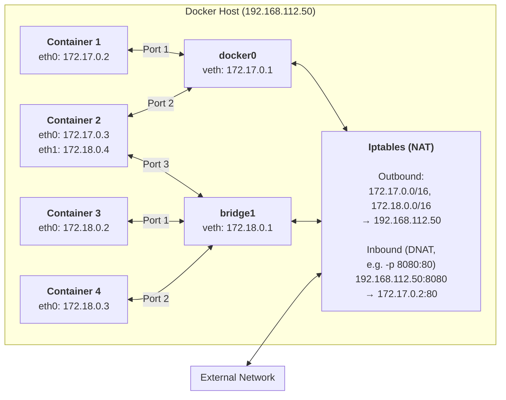

# Docker Networking

## Docker Network Modes (Drivers)

- **Bridge (default)**: The default network driver.
- **Host**: Remove network isolation between the container and the Docker Host.
- **None**: Completly isolate a container from the host and other containers.
- **Overlay**: Overlay networks connect multiple Docker daemons together.
- **Ipvlan**: IPvlan networks provide full control over both IPv4 and IPv6 adressing.
- **Macvlan**: Assign a MAC address to a container.
- **Userdefined**: Custom network.

### Bridge Mode (Driver)

!!! note "Short recap: Network Bridges"
    A bridge is a data link-layer (OSI layer 2) physical or virtual  device that forwards traffic between two or more network segments.

- In Docker, a bridge network uses a software bridge to allow containers to communicate inside the docker host.
- By default, when you start Docker, a bridge (docker0) is created automatically.
- Containers are connected to this bridge by default.
- It isolates its containers from other containers on other bridges
- A container can connect to multiple bridge networks at the same time.
- The ports owner are the bridges.
- Each container created in bridge mode has an eth0 with assigned IP address
- Docker Host maintains NAT entries in Iptables. (e.g. Iptable NAT: 172.17.0.2 <-> 192.168.112.50)

Example:



!!! info "Network interfaces on the Docker Host"
    `ip a` on the Docker Host shows one `vethXXXX` interface for every container connection. Each `vethXXXX` is the host end of a virtual cable and is plugged into a bridge (`docker0` or `bridge1`), which you can see from `master docker0` / `master bridge1`. The other end of the cable is the `eth0` interface inside the container. A container in two networks (Container 2) has two cables and therefore two `veth` interfaces on the host.

```bash
# On the Docker Host
ip a

1: lo: <LOOPBACK,UP,LOWER_UP> mtu 65536 state UNKNOWN
    inet 127.0.0.1/8 scope host lo
2: eth0: <BROADCAST,MULTICAST,UP,LOWER_UP> mtu 1500 state UP
    link/ether 00:50:56:aa:bb:cc brd ff:ff:ff:ff:ff:ff
    inet 192.168.112.50/24 brd 192.168.112.255 scope global eth0
3: docker0: <BROADCAST,MULTICAST,UP,LOWER_UP> mtu 1500 state UP
    link/ether 02:42:11:22:33:44 brd ff:ff:ff:ff:ff:ff
    inet 172.17.0.1/16 brd 172.17.255.255 scope global docker0
4: bridge1: <BROADCAST,MULTICAST,UP,LOWER_UP> mtu 1500 state UP
    link/ether 02:42:55:66:77:88 brd ff:ff:ff:ff:ff:ff
    inet 172.18.0.1/16 brd 172.18.255.255 scope global bridge1
5: veth1a2b3c4@if10: <BROADCAST,MULTICAST,UP,LOWER_UP> mtu 1500 master docker0 state UP
    link/ether 6a:01:02:03:04:05 brd ff:ff:ff:ff:ff:ff link-netnsid 0
6: veth5d6e7f8@if12: <BROADCAST,MULTICAST,UP,LOWER_UP> mtu 1500 master docker0 state UP
    link/ether 6a:11:12:13:14:15 brd ff:ff:ff:ff:ff:ff link-netnsid 1
7: veth9a8b7c6@if14: <BROADCAST,MULTICAST,UP,LOWER_UP> mtu 1500 master bridge1 state UP
    link/ether 6a:21:22:23:24:25 brd ff:ff:ff:ff:ff:ff link-netnsid 1
8: vethd4e5f6a@if16: <BROADCAST,MULTICAST,UP,LOWER_UP> mtu 1500 master bridge1 state UP
    link/ether 6a:31:32:33:34:35 brd ff:ff:ff:ff:ff:ff link-netnsid 2
9: veth0b1c2d3@if18: <BROADCAST,MULTICAST,UP,LOWER_UP> mtu 1500 master bridge1 state UP
    link/ether 6a:41:42:43:44:45 brd ff:ff:ff:ff:ff:ff link-netnsid 3
```

!!! info
    When a container is not running, the `veth` port of the container disappears on side of the Docker Host.

#### Default Bridge (docker0)

- IP subnet of docker0: `172.17.0.0/16`
- docker0 has the default gateway: `172.17.0.1`
- Unless other specified, all newly created containers attach to docker0.
- Each container created in bridge mode has an eth0 with an assigned IP address.

## Network Commands

```bash
ip a
	# Shows network interfaces and their associated IP on Linux
docker network ls
	# List all available networks
docker network create <NAME>
	# Creates a new network with a specific name
	# Without specifying the subnet, it will go one higher, e.g. from
	# 172.17.0.0/16 to 172.18.0.0/16, then .19, .20, ...
docker network create --subnet 10.0.0.0/16 <NETWORK-NAME>
	# Create a new network with a custom subnet range
docker network inspect <NETWORK-NAME or ID>
	# Get details to a network
docker run --network <NETWORK-NAME> <IMAGE>
	# Run a new container and connect it to a Docker network
docker network connect <NETWORK-NAME> <CONTAINER>
	# Connect a running container to a Docker network
docker network disconnect <NETWORK-NAME> <CONTAINER>
	# Disconnect a running container from a Docker network
	# Does not work with none and host network modes
```
